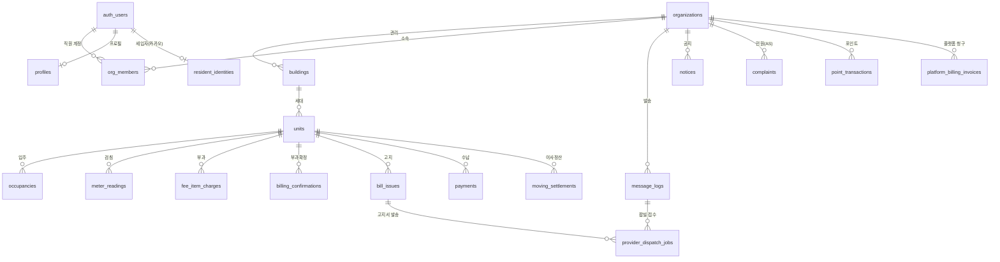
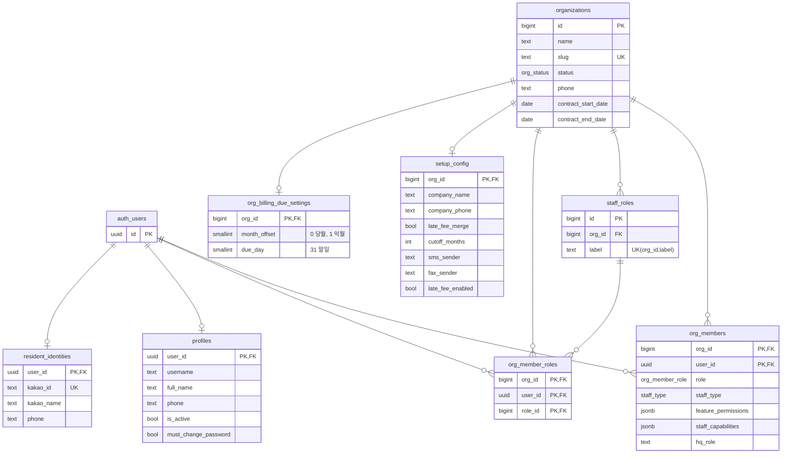
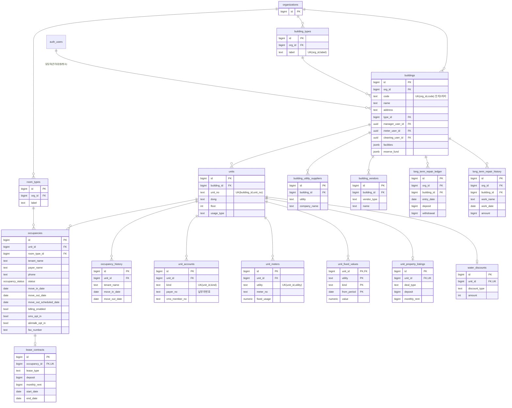
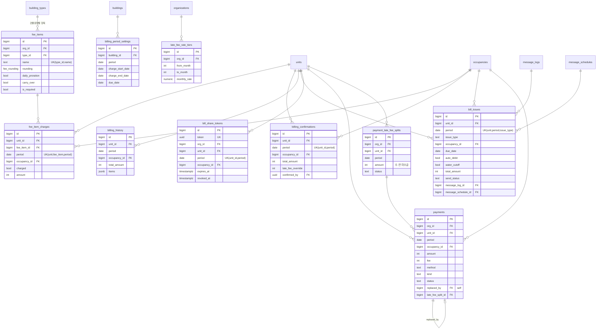
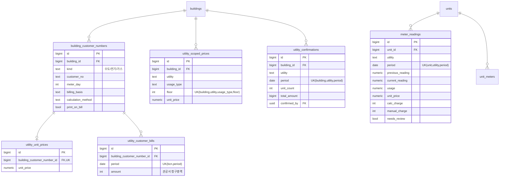
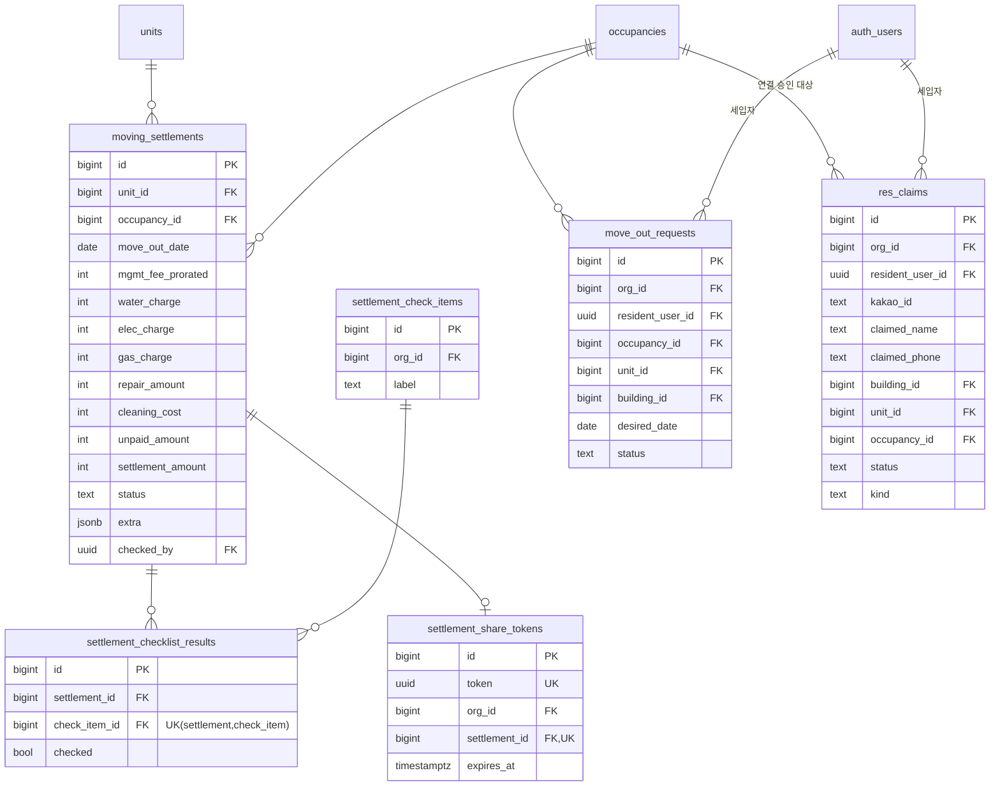
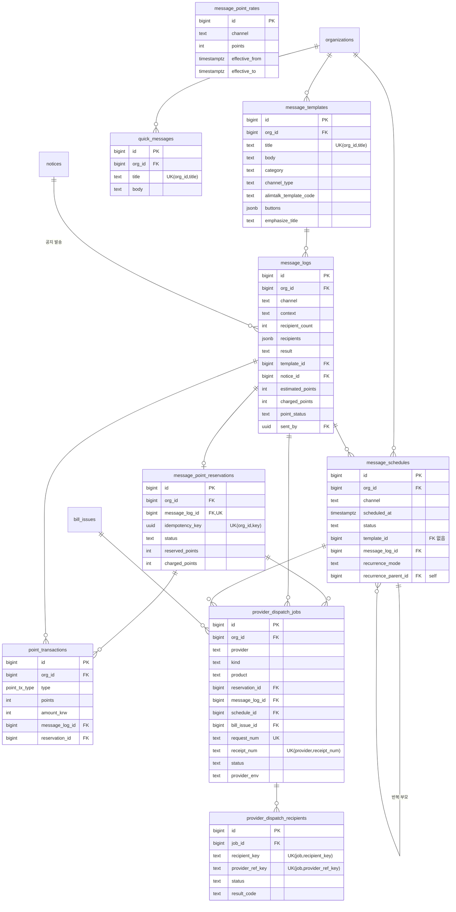
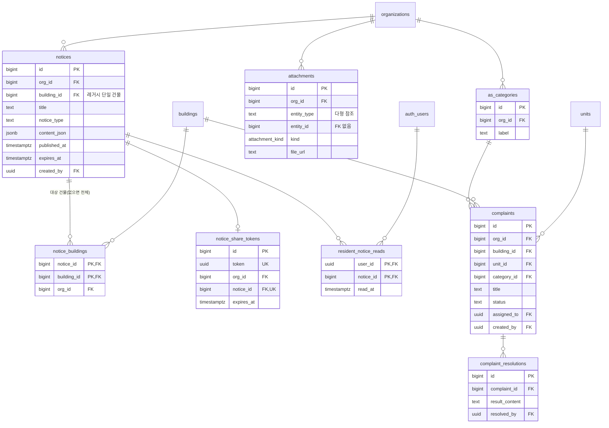
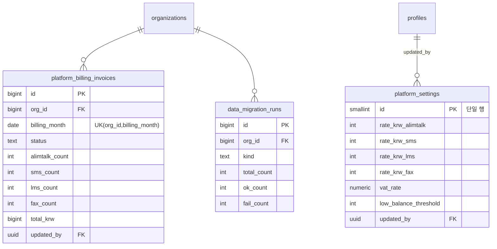

# 관리비서 주택관리 ERP — 데이터베이스 ERD

- 기준: Supabase 프로젝트 `amhtprmapxlizdnsgbeg`, `public` 스키마 실DB 조회 결과(2026-10-13)
- 규모: 테이블 74개, 외래키(FK) 148개
- 표기: `PK` 기본키, `FK` 외래키, `UK` 유니크(복합 포함). `||--o{` 1:N, `||--o|` 1:0..1
- `auth_users` 는 Supabase `auth.users`(로그인 계정)를 뜻한다. 직원·현장·통합관리자·세입자 모두 이 계정을 쓴다.
- 다이어그램은 도메인별로 나누고, 각 엔터티에는 키 컬럼과 핵심 업무 컬럼만 적었다. 전체 컬럼은 맨 아래 「테이블 목록」과 `supabase/migrations/` 를 본다.

## 0. 전체 개요 (도메인 간 연결)

## 1. 조직 · 계정 · 권한

FK 없는 보조 테이블: `access_log`(개인정보 열람 감사, org_id·actor_id FK 없음 — 조직/계정 삭제 후에도 이력 보존), `audit_log`(변경 감사), `login_rate_limit`(로그인 무차별 대입 제한 버킷), `app_secrets`(서버 비밀값 키-값).

## 2. 건물 · 세대 · 입주

조직 단위 코드성 테이블(모두 `organizations` 1:N): `room_types`, `building_types`, `cleaning_teams`, `septic_vendors`, `vendor_categories` → `vendors`(협력업체, `category_id` FK), `settlement_check_items`, `as_categories`.

## 3. 부과 · 고지 · 수납

확정자·처리자 컬럼(`confirmed_by`, `issued_by`, `created_by`, `canceled_by`)은 `profiles.user_id` 를 참조한다.

## 4. 공과금 · 검침

## 5. 이사정산 · 퇴실 · 세대연결

## 6. 메시지 · 발송(팝빌) · 포인트

## 7. 공지 · 민원(AS) · 첨부

## 8. 플랫폼(통합관리자)

## 테이블 목록 (74)

| 도메인 | 테이블 | 설명 |
|---|---|---|
| 조직·계정 | organizations | 관리회사(조직) |
| | profiles | 로그인 계정 프로필(auth.users 1:1) |
| | org_members | 조직 소속 직원·역할·기능 권한 |
| | staff_roles / org_member_roles | 조직별 직책과 직원-직책 매핑 |
| | resident_identities | 세입자 카카오 계정 정보(auth.users 1:1) |
| | setup_config | 조직 셋업(회사 정보, 고지서·연체료 옵션, 발신번호) |
| | org_billing_due_settings | 조직 기본 납부기한 |
| | access_log / audit_log | 개인정보 열람 감사 / 데이터 변경 감사(FK 없음) |
| | login_rate_limit / app_secrets | 로그인 제한 버킷 / 서버 비밀값 |
| 건물·세대 | buildings | 건물(조직 내 코드 3자리 유니크) |
| | building_types | 건물 유형(관리비 항목 묶음 기준) |
| | units | 세대(호실) |
| | occupancies | 입주(세입자) — 현재·과거 입주 행 |
| | occupancy_history | 이전 입주자 이력 |
| | lease_contracts | 임대차 계약(입주 1:1) |
| | room_types | 방 타입 |
| | unit_accounts | 세대 계좌·납부자번호·CMS |
| | unit_meters / unit_fixed_values | 세대 계량기·고정 사용량 / 기간별 고정값 |
| | unit_property_listings | 공실 매물 정보(세대 1:1) |
| | water_discounts | 수도 감면(세대 1:1) |
| | building_utility_suppliers / building_vendors | 건물 공급사·업체 정보 |
| | long_term_repair_ledger / long_term_repair_history | 장기수선충당금 장부 / 수선 이력 |
| | cleaning_teams / septic_vendors | 청소팀·정화조 업체 코드 |
| | vendor_categories / vendors | 협력업체 분류 / 협력업체 |
| 부과·수납 | fee_items / fee_item_charges | 관리비 항목 / 세대·월별 부과 금액 |
| | billing_period_settings | 건물·월별 부과기간·납기일 |
| | billing_confirmations / billing_history | 세대·월 부과확정 / 확정 스냅샷 이력 |
| | late_fee_rate_tiers | 연체료 구간 요율 |
| | bill_issues | 고지서 발행·발송 상태(세대·월·유형) |
| | bill_share_tokens | 고지서 공개 공유 토큰 |
| | payments | 수납(취소·대체 이력 포함) |
| | payment_late_fee_splits | 수.연(연체료 분리) 미수금 |
| 공과금 | building_customer_numbers | 건물 공과금 고객번호(수도·전기·가스) |
| | utility_unit_prices / utility_scoped_prices | 고객번호 단가 / 용도·층별 단가 |
| | utility_customer_bills | 고객번호·월 관공서 청구총액 |
| | utility_confirmations | 건물·공과금·월 확정 |
| | meter_readings | 세대·공과금·월 검침 |
| 이사정산 | moving_settlements | 이사정산 |
| | settlement_check_items / settlement_checklist_results | 퇴실 점검 항목 / 정산별 점검 결과 |
| | settlement_share_tokens | 정산 공개 공유 토큰 |
| | move_out_requests | 세입자 퇴실 신청 |
| | res_claims | 세입자 세대연결 요청 |
| 메시지 | message_templates / quick_messages | 문자·알림톡 템플릿 / 빠른 문구 |
| | message_logs / message_schedules | 발송 이력 / 예약·반복 발송 |
| | message_point_rates / message_point_reservations / point_transactions | 채널별 포인트 단가 / 발송 포인트 예약 / 포인트 거래 |
| | provider_dispatch_jobs / provider_dispatch_recipients | 팝빌 접수 단위 / 수신자별 결과 |
| 공지·민원 | notices / notice_buildings | 공지 / 공지 대상 건물(없으면 전체) |
| | notice_share_tokens / resident_notice_reads | 공지 공유 토큰 / 세입자 읽음 |
| | as_categories / complaints / complaint_resolutions | AS 분류 / 민원 / 처리 결과 |
| | attachments | 첨부파일(entity_type·entity_id 다형 참조) |
| 플랫폼 | platform_settings | 플랫폼 단가·청구 설정(단일 행) |
| | platform_billing_invoices | 조직별 월 이용료 청구서 |
| | data_migration_runs | 데이터 이관 실행 이력 |

## 참고 — FK 없이 값으로 연결되는 컬럼

- `message_schedules.template_id` → `message_templates.id` (FK 없음)
- `attachments.entity_type` + `entity_id` → 여러 테이블(다형)
- `access_log`, `audit_log` 의 `org_id`, `actor_id` (이력 보존 목적)
- `org_billing_due_settings.updated_by`, `utility_customer_bills.updated_by`, `attachments.uploaded_by`, `data_migration_runs.run_by` → 계정 uuid (FK 없음)
