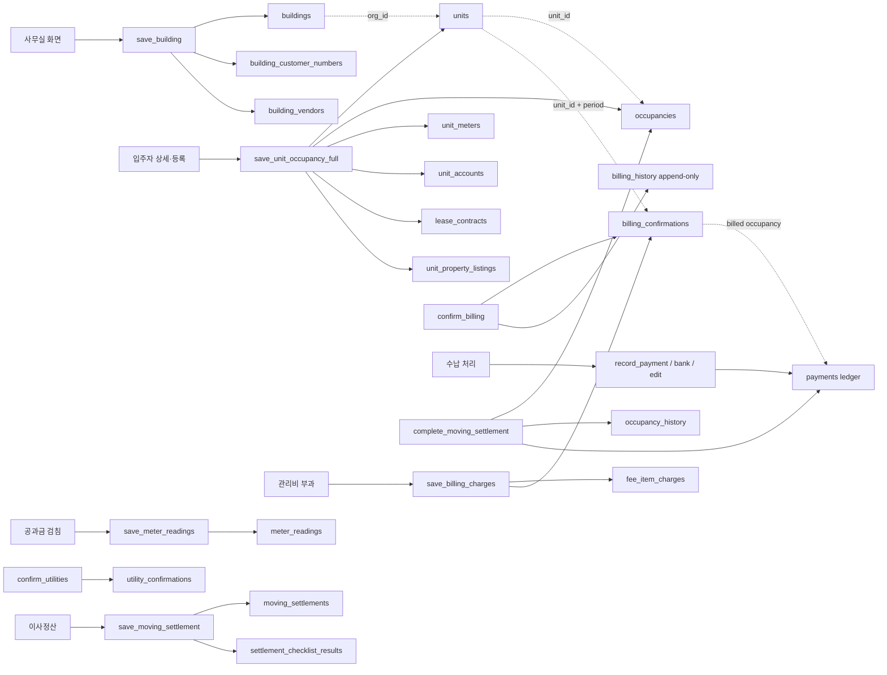

# Home ERP 데이터 정합성 감사

- 기준일: 2026-09-22
- 대상: 화면 입력값 → React Query API → Supabase RPC → 테이블/관계키/이력
- 방식: 소스·마이그레이션 정적 대조와 `.env.local`에 설정된 Supabase의 읽기 전용 행 대사. 어떤 데이터도 생성·수정·삭제하지 않았다.
- 선행 문서: [화면·API 기능 체크리스트](2026-09-22-home-erp-screen-api-checklist.md), [구현 연결 감사](2026-09-22-home-erp-screen-api-code-audit.md)

## 결론

핵심 업무 흐름(건물, 입주자, 부과, 검침, 수납, 이사정산)은 화면이 보내는 식별자와 데이터가 의도한 테이블로 이어진다. RPC는 조직 범위, 부모-자식 관계, 월 기준일, 중복 키, 상태 전이를 대부분 검증한다.

실제 데이터도 읽기 전용으로 대사했다. 핵심 관계·조직 귀속·중복·검침 검토 상태는 모두 정상이다. 단, 이사정산의 청소비가 최신 저장 RPC의 합계 계산에서 빠지는 재발 위험을 발견했다. 또한 일부 관계 일치는 RPC에서만 검증되고 DB의 복합 외래키로 강제되지는 않는다.

## 현재 데이터 대사 결과

`.env.local`에 설정된 Supabase에서 아래 행을 전수 읽기 전용으로 확인했다. 개인정보는 조회 결과에 포함하지 않았다.

| 대상 | 전수 확인 행 수 | 결과 |
| --- | ---: | --- |
| 건물 / 세대 / 입주자 | 4 / 37 / 37 | 세대의 없는 건물 참조 0건, 입주자의 없는 세대 참조 0건 |
| 수납 | 64 | 입주자-세대 불일치 0건, 조직 불일치 0건, 활성 은행수납 논리 중복 0건 |
| 관리비 확정 / 부과 항목 | 112 / 536 | 입주자-세대 불일치 0건 |
| 이사정산 | 11 | 입주자-세대 불일치 0건. 청소비 포함 총액 공식 기준 불일치 0건 |
| 공과금 검침 | 201 | 음수 사용량인데 검토 대기 표시가 없는 행 0건 |
| 고지서 / 발송 | 31 / 16 / 23 | 고지서 입주자-세대 불일치 0건, 발송 이력·예약 수신자 수 불일치 0건 |
| 민원 / 장기수선 | 1 / 11 | 민원의 조직·건물·세대·카테고리 불일치 0건, 장기수선 원장의 조직·건물 불일치 0건 |
| 플랫폼 청구 / 포인트 | 0 / 1 | 청구서의 월 기준·합계·조직 불일치 0건, 포인트 부호·조직 불일치 0건 |

이사정산 4건은 `청소비`를 제외하면 총액과 차이가 났지만, 화면의 총액 공식과 같이 청소비를 포함하면 모두 일치했다. 즉 **기존 데이터는 정상**이고, 아래 저장 경로의 계산 누락이 향후 데이터를 깨뜨릴 위험이다.

청소비 누락 방지를 위해 `0191_settlement_total_cleaning_cost.sql` 마이그레이션과 `p7_settlement_total_checks.sql` 회귀 검증을 추가했다. 마이그레이션은 아직 현재 Supabase에 적용하지 않았으며, 적용 뒤 검증 SQL을 실행해야 한다.

## 핵심 데이터 노드



`조직 범위 + 권한 모듈` 검증은 모든 쓰기 RPC의 시작 조건이다. 아래의 `DB 제약`은 어떤 통로로 입력해도 보장되고, `RPC 제약`은 현재 애플리케이션 경로를 탈 때 보장된다.

## 화면별 핵심 쓰기 흐름

| 화면/업무 | 클라이언트 호출 | 저장 대상 | 정합성 장치 | 판정 |
| --- | --- | --- | --- | --- |
| 건물 등록·수정 | `save_building` | `buildings`, `building_customer_numbers`, `building_vendors` | `current_user_org`, `buildings` 모듈 검사. 직원 ID는 같은 조직의 `org_members`에서만 선택. 수정/삭제 대상은 `building_id`로 한정 | 연결 확인 |
| 입주자·세대 등록 | `save_unit_occupancy_full` → `save_unit_occupancy` | `units`, `occupancies`, `unit_meters`, `unit_accounts`, `lease_contracts`, `unit_property_listings` | 건물의 조직 소유 확인 후 세대는 해당 건물, 입주자는 해당 세대로 한정. 계량기·계좌·임대·매물은 각각 세대/입주자 단위 upsert | 연결 확인 |
| 관리비 부과 입력 | `save_billing_charges` | `fee_item_charges`, `billing_confirmations` | 건물·세대·부과항목의 조직/건물 유형을 검증. 기간은 매월 1일·미래 금지. `(unit_id, fee_item_id, period)` 및 `(unit_id, period)` 유니크 | 연결 확인 |
| 관리비 확정 | `confirm_billing` | `billing_confirmations`, `billing_history`, `audit_log` | 공실 제외, 당월 입주 일할 계산, 동일 세대·월 확정은 upsert. 확정 이력은 append-only | 연결 확인; 이력 소비 시 최신 건 기준 필요 |
| 공과금 검침 | `save_meter_readings` | `meter_readings` | 세대가 요청 건물·조직 소속인지 확인. 검침 종류/월 기준/미래 기간 검사. 사용량이 검침 차와 불일치하면 차단. `(unit_id, utility, period)` upsert | 연결 확인 |
| 공과금 확정 | `confirm_utilities` | `utility_confirmations`, `audit_log` | 음수 검침 등 `needs_review` 세대가 있으면 확정 차단. `(building_id, utility, period)` upsert | 연결 확인 |
| 수납 입력·수정·은행 업로드 | `record_payment`, `record_payment_edit`, `record_bank_payments` | `payments`, `audit_log` | 세대의 조직 소유, 월 기준, 금액/수수료/수납수단 검사. 확정부과의 `occupancy_id`를 우선 귀속. 은행 업로드는 활성 행 논리키 유니크로 재업로드 중복 방지 | 연결 확인 |
| 이사정산 저장 | `save_moving_settlement`, `partner_save_moving_settlement` | `moving_settlements`, `settlement_checklist_results` | 세대 조직/협력사 배정, 입주자-세대 관계, 점검항목 조직을 검사. 점검항목은 `(settlement_id, check_item_id)` upsert | 관계는 정상, 총액 계산 보완 필요 |
| 이사정산 완료 | `complete_moving_settlement` | `moving_settlements`, `occupancies`, `occupancy_history`, 조건부 `payments` | 정산 행 잠금, 완료 상태는 멱등 반환. 입주자를 공실로 전환하고 이력을 남김. 자동수납은 부과 당시 입주자 귀속으로 미납만 기록 | 연결 확인 |

## 필드·테이블 매핑 확인

### 1. 건물

`SaveBuildingPayload`의 기본값은 `buildings`에, 고객번호 배열은 `building_customer_numbers`에, 업체 배열은 `building_vendors`에 들어간다. 고객번호/업체 기존 행의 변경과 숨김 처리 모두 요청된 건물 ID로 제한된다. 즉, 화면에서 전달한 하위 ID만으로 다른 건물의 하위 행을 수정하는 경로는 RPC상 없다.

`buildings.org_id`는 화면에서 받지 않고 현재 로그인 조직에서 강제한다. 이것이 화면 payload의 조직 ID 위조를 막는다.

### 2. 입주자·세대

현재 클라이언트 payload와 최종 RPC의 필드를 대조했다.

| 화면 payload | 대상 테이블 | 비고 |
| --- | --- | --- |
| `unit_no`, `dong`, `area_pyeong`, `room_count`, `floor`, `usage_type` | `units` | 세대 신규/수정 모두 반영 |
| 인적 정보, 청구 설정, 퇴실 예정일, 알림 동의, CMS 번호 | `occupancies` | core 저장 후 확장 컬럼 update |
| 계량기 번호·고객 번호 | `unit_meters` | `(unit_id, utility)` upsert |
| 계좌·CMS·납부자 번호 | `unit_accounts` | `(unit_id, kind)` upsert |
| 보증금·임대기간·임대유형 | `lease_contracts` | `(occupancy_id)` upsert |
| 매물·시설 | `unit_property_listings` | `(unit_id)` upsert 및 삭제 해제 |

이전 마이그레이션의 `floor`, `usage_type`, `payer_no`, `transfer_method` 등이 누락되었을 가능성도 확인했으나, 최신 `save_unit_occupancy` 재정의와 `save_unit_occupancy_full` 경로에서 모두 반영된다.

### 3. 부과·수납·검침의 월별 기준

세 흐름 모두 월의 첫날을 기준 기간으로 강제한다. 따라서 일 단위 값을 사용해 같은 달의 별도 행을 만드는 경로가 없다.

| 원장 | 고유 기준 | 계산/귀속 |
| --- | --- | --- |
| `fee_item_charges` | 세대 + 부과항목 + 월 | 부과 입력값 |
| `billing_confirmations` | 세대 + 월 | 확정 합계 및 부과 시점 입주자 |
| `billing_history` | append-only | 재확정도 별도 이력으로 남김 |
| `meter_readings` | 세대 + 공과금 종류 + 월 | 직전 검침/현재 검침/단가/할인 스냅샷 |
| `utility_confirmations` | 건물 + 공과금 종류 + 월 | 확정 세대 수·총액 |
| `payments` | 원장 행 | 확정부과의 입주자 우선 귀속; 은행 업로드만 별도 논리키 유니크 |

`billing_history`는 재확정할 때 새 행을 추가하는 설계다. 따라서 “해당 월 이력 건수 = 1”로 가정하는 조회나 리포트가 있다면 오답이 될 수 있으며, 최신 `confirmed_at`을 기준으로 읽어야 한다.

### 4. 이사정산의 상태 전이

`saved/draft` 상태의 정산만 수정할 수 있고, 완료 시 다음 세 가지가 한 함수 안에서 처리된다.

1. `moving_settlements.status`를 `completed`로 전환한다.
2. 같은 세대의 대상 입주자를 `vacant`로 바꾸고 `occupancy_history`에 스냅샷을 남긴다.
3. 설정이 `auto`이면 각 확정부과 월의 남은 미납액만 `payments` 원장에 기록한다.

완료된 정산을 다시 호출하면 성공 결과만 반환하므로, 중복 완료로 동일 수납을 다시 기록하지 않는다.

정산 총액은 화면과 기존 데이터에서 `관리비 일할 + 수도 + 전기 + 가스 + 수선 + 청소비`다. 그러나 최신 `save_moving_settlement` 및 `partner_save_moving_settlement`의 `v_amount`는 청소비를 제외한 다섯 항목만 더한다. 두 화면 모두 `cleaning_cost`를 payload로 보내고 컬럼에도 저장하므로, 새 저장 또는 기존 draft/saved 행의 수정 시 `settlement_amount`만 청소비만큼 작아질 수 있다.

## 정합성 강도와 보완할 부분

| 우선순위 | 항목 | 근거와 영향 | 권장 조치 |
| --- | --- | --- | --- |
| 높음 | 이사정산 총액에서 청소비 누락 | 모바일·사무실 화면은 청소비를 총액에 더하고 기존 11건도 그 공식과 일치한다. 하지만 두 최신 저장 RPC는 `cleaning_cost`를 저장만 하고 `settlement_amount` 계산에서는 제외한다. | 두 RPC의 합계식에 `coalesce(nullif(p_data->>'cleaning_cost','')::integer, 0)`를 추가하고, 청소비 포함 회귀 테스트를 작성 |
| 높음 | 관계 일치가 일부 RPC에만 있음 | `billing_confirmations.occupancy_id`, `fee_item_charges.occupancy_id`, `payments.occupancy_id`, `moving_settlements.occupancy_id`는 단일 FK라 존재 여부는 보장하지만 “같은 `unit_id` 소속”이라는 복합 관계는 FK로 강제되지 않는다. 현재 RPC는 검사하지만 테이블 RLS 쓰기 권한이 있는 사용자의 직접 PostgREST 쓰기까지 구조적으로 막지는 못한다. | 쓰기를 RPC 전용으로 제한하거나, composite FK/트리거로 `occupancy.unit_id = row.unit_id`를 DB에서도 강제 |
| 중간 | 정산 구성금액의 원천 대조 | RPC는 화면 payload의 금액을 합산한다. 합계는 서버에서 재계산하되 각 항목이 원천 부과/검침과 자동 일치하는지는 별도 업무 규칙이다. | 단위/통합 테스트에 원천 금액과 정산 payload 일치 여부 추가 |
| 중간 | 부과 이력의 다건성 | 재확정 시 `billing_history`를 append한다. 설계 의도이지만 집계 구현이 최신값을 선택하지 않으면 중복 합산될 수 있다. | 리포트·내보내기 쿼리를 최신 확정 시각 기준으로 검사 |
| 낮음 | 일부 기준정보는 테이블 직접 CRUD | 예: `fee_items`는 클라이언트가 테이블 CRUD를 사용하며 조직 RLS로 범위는 제한된다. 업무 모듈 권한이나 불변식은 RPC 경로보다 약하다. | 기준정보도 모듈 권한 포함 RPC로 통일할지 결정 |

## 운영 DB에서 실행할 읽기 전용 대사

아래는 실제 데이터가 맞는 테이블에 들어가 있는지 확인하는 1차 SQL이다. 실행 전 대상이 운영인지 스테이징인지 명시하고, `select`만 허용되는 읽기 전용 계정으로 실행한다.

```sql
-- 1) 모든 입주자 귀속 행이 자기 세대를 가리키는지
select p.id, p.unit_id, p.occupancy_id, o.unit_id as occupancy_unit_id
from payments p
join occupancies o on o.id = p.occupancy_id
where p.occupancy_id is not null
  and p.unit_id <> o.unit_id;

-- 2) 부과 확정과 귀속 입주자의 세대 불일치
select bc.id, bc.unit_id, bc.occupancy_id, o.unit_id as occupancy_unit_id
from billing_confirmations bc
join occupancies o on o.id = bc.occupancy_id
where bc.occupancy_id is not null
  and bc.unit_id <> o.unit_id;

-- 3) 정산과 입주자의 세대 불일치
select s.id, s.unit_id, s.occupancy_id, o.unit_id as occupancy_unit_id
from moving_settlements s
join occupancies o on o.id = s.occupancy_id
where s.occupancy_id is not null
  and s.unit_id <> o.unit_id;

-- 4) 정산 저장 총액과 구성 항목 합계 불일치
select id, settlement_amount,
       coalesce(mgmt_fee_prorated, 0) + coalesce(water_charge, 0)
       + coalesce(elec_charge, 0) + coalesce(gas_charge, 0)
       + coalesce(repair_amount, 0) + coalesce(cleaning_cost, 0) as expected_amount
from moving_settlements
where settlement_amount <> coalesce(mgmt_fee_prorated, 0) + coalesce(water_charge, 0)
  + coalesce(elec_charge, 0) + coalesce(gas_charge, 0)
  + coalesce(repair_amount, 0) + coalesce(cleaning_cost, 0);

-- 5) 활성 은행 수납의 논리적 중복
select org_id, unit_id, period, amount, paid_at, coalesce(memo, ''), count(*)
from payments
where source = 'bank_excel' and status = 'active'
group by org_id, unit_id, period, amount, paid_at, coalesce(memo, '')
having count(*) > 1;

-- 6) 검침의 음수 사용량이 검토 대기 없이 남아 있는지
select id, unit_id, utility, period, previous_reading, current_reading, usage, needs_review
from meter_readings
where usage < 0 and coalesce(needs_review, false) = false;
```

반환 행이 0건이어야 정상이다. 단, 과거 데이터에서 `occupancy_id`가 null인 행은 이 쿼리에서 오류로 보지 않으며, 당시 귀속 정책에 따라 별도 검토 대상이다.

## 다음 검증 순서

1. 청소비 포함 RPC 합계식 수정 여부를 결정하고, 수정 전 새 정산을 저장하지 않도록 업무 담당자에게 공유한다.
2. 수정 뒤 청소비가 있는 신규·수정 정산을 저장하는 회귀 테스트를 실행한다. 완료된 기존 11건은 현재 공식과 일치하므로 일괄 정정 대상이 아니다.
3. 이후 메시지, 고지서, 민원, 장기수선, 플랫폼 정산도 같은 노드 형식으로 확장한다.
