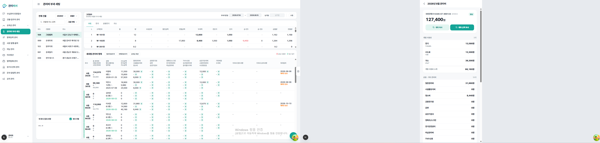

# 공과금 표시 차이 비교 — 사무실 관리자 vs 세입자

- 확인일: 2026-10-18
- 기준 인물: **그린빌라 902호 이서연**(세입자 앱 연결 계정 1명, 세대 연결 상태 `linked`)
- 확인 방법: Supabase 데이터 직접 조회(각 화면이 읽는 RPC·테이블 기준)

## 1. 화면별 데이터 출처

| 화면 | 공과금 금액 출처 | 사용량 출처 |
|---|---|---|
| 사무실 관리자 › 공과금(수도·전기·가스) | `meter_readings`: `manual_charge ?? calc_charge` (실시간) | `meter_readings`: 당월 지침 − 전월 지침 |
| 사무실 관리자 › 관리비 부과 세팅 | `fee_item_charges` 있으면 그 값, 없으면 공과금 화면 값 | — |
| 세입자 › 관리비 상세고지서 (`resident_bill_detail`) | `fee_item_charges` (관리비 확정 시점 값) | `meter_readings.usage` |

→ 세입자 화면은 **관리비 부과 세팅**과 같은 값을 보여주고, **공과금 화면**과는 다를 수 있습니다.
공과금 화면 값은 관리비 부과 세팅에서 `공과금 계산` → `저장`을 해야 `fee_item_charges`에 복사됩니다(DB 트리거·자동 동기화 없음).

## 2. 902호 이서연 월별 비교

| 월 | 항목 | 공과금 화면 | 관리비 부과·세입자 | 차이 | 원인 |
|---|---|---:|---:|---:|---|
| 2026-08 | 전기 | 14,560 | 13,580 | +980 | 관리비 확정(10/10 03:30) **후** 공과금 재계산(10/11 07:09) |
| 2026-08 | 수도료 | 12,600 | 13,300 | −700 | 같음 |
| 2026-08 | 가스 | 40,180 | 39,300 | +880 | 같음 |
| 2026-09 | 전기 / 수도료 / 가스 | (공란) | 13,520 / 13,650 / 46,400 | — | 공과금 검침·부과액 없음. 관리비 항목이 `전월 이월(carry_over)`이라 이전 금액이 복사됨 |
| 2026-10 | 전기 / 수도료 / 가스 | (공란) | 13,520 / 13,650 / 46,400 | — | 같음 |

## 3. 다른 세대에서도 같은 유형 발생

| 세대 | 월 | 항목 | 공과금 화면 | 세입자 | 유형 |
|---|---|---|---:|---:|---|
| 그린빌라 101호 | 2026-09 | 전기 | 123 (수동입력) | 14,560 | 확정 후 공과금 수정 |
| 그린빌라 101호 | 2026-07 | 가스 | 1 (수동입력) | 24,500 | 확정 후 공과금 수정 |
| 그린빌라 201호 | 2026-08·09 | 전기·수도·가스 | (공란) | 38,700 등 | 공과금 부과액 없음(이월·직접 입력값) |

## 4. 원인 요약

1. **세입자 고지서가 사무실 고지서와 다른 데이터를 읽었다.** 사무실 고지서 출력·팩스는 확정 스냅샷(`billing_history.items`)을 쓰는데, 세입자 화면은 `fee_item_charges`를 읽었다. 관리비 저장은 손댄 칸만 `fee_item_charges`에 쓰고, 확정 시 빈 칸은 공과금 부과액·이월값·일할 계산으로 채워 스냅샷과 합계에만 남는다. 그래서 확정 고지서 252건 중 179건에서 세입자 항목 합 ≠ 확정 합계였다.
2. **관리비 확정 이후 공과금이 바뀌어도 감지되지 않았다.** 관리비 부과 화면의 `재확정 필요`는 관리비 항목 수정만 감지했다.
3. **공과금 부과액이 없는 달**에는 공과금 항목의 `전월 이월` 설정 때문에 서버 기본값 계산에서 이전 달 금액이 넘어갔다. 공과금 화면은 공란으로 보였다.

## 5. 수정 내용 (`supabase/migrations/0324_resident_bill_snapshot_utility_dirty.sql`, 운영 DB 적용 완료)

| # | 결정 | 변경 |
|---|---|---|
| 1 | 세입자 = 사무실 고지서 | `resident_bill_detail`·공유 링크(`public_bill_by_signed`)의 항목 금액을 사무실 고지서와 같은 확정 스냅샷으로 표시. 사용량도 공과금 화면과 같이 (당월 − 전월 지침)으로 보정 |
| 2 | 변경 감지 후 재반영 안내 | 확정 후 공과금 부과액이 확정 금액과 달라지면 관리비 부과 화면에 `재확정 필요` 표시. 직원이 `공과금 계산` → 저장하면 고지서·세입자 앱에 반영. 확정 금액은 자동으로 바꾸지 않음 |
| 3 | 공과금은 이월하지 않기 | `list_billing`·`confirm_billing`·`charge_new_occupancies`의 전월 이월 기본값에서 수도·전기·가스 제외 |

정책서 반영: `사무실 관리자_관리비 부과 세팅.md` 3.6, `세입자_관리비 상세고지서.md` 3.2

## 6. 수정 후 검증 (902호 이서연 계정으로 RPC 직접 호출)

| 월 | 세입자 앱 (전기 / 수도료 / 가스) | 세입자 항목 합 = 확정 합계 | 사무실 고지서 | 관리비 부과 화면 |
|---|---|---|---|---|
| 2026-07 | 14,670 / 14,360 / 42,440 | 137,580 = 137,580 | (스냅샷 없음) | 정상 |
| 2026-08 | 13,580 / 13,300 / 39,300 | 127,400 = 127,400 | (스냅샷 없음) | **재확정 필요** (공과금 14,560 / 12,600 / 40,180로 바뀜) |
| 2026-09 | 13,520 / 13,650 / 46,400 | 119,990 = 119,990 | 동일 | 정상 |
| 2026-10 | 13,520 / 13,650 / 46,400 | 119,990 = 119,990 | 동일 | 정상 |

전체: 확정 고지서 252건 중 스냅샷이 있는 189건은 세입자 화면 = 사무실 고지서 **불일치 0건**.
스냅샷이 없는 63건(그린빌라·블루타워·TC2C 테스트 시드 자료)은 사무실 고지서에도 항목이 없어 기존 방식(`fee_item_charges`)대로 표시한다.

남은 작업: 902호 8월은 직원이 관리비 부과에서 `공과금 계산` → 저장해야 새 공과금이 반영된다. 9·10월은 이미 확정된 금액(이전 이월값)이라 그대로 보이고, 다시 확정하면 공과금이 없는 항목은 0원이 된다.

## 7. 화면 캡쳐 — 902호 이서연 2026년 8월

| 항목 | 사무실 › 관리비 부과 세팅 | 세입자 앱 | 설명 |
|---|---:|---:|---|
| 수도 | 12,600 | 13,300 | 아래 ① |
| 전기 | 14,560 | 13,580 | 아래 ① |
| 가스 | 40,180 | 39,300 | 아래 ① |
| 총 관리비 | 118,950 (`재확정 필요`) | 127,400 | 아래 ② |

① **관리비 부과 세팅의 `수도금액·전기금액·가스금액` 칸은 고지서 금액이 아니다.** 공과금 화면의 **현재** 부과액을 그대로 보여주는 참고 칸이다(`BillingTableRow.tsx` `unitUtilityAmounts`). 실제 고지서에 들어가는 `전기·수도료·가스` 항목은 이 화면에서 숨겨져 있다(`BillingTable.tsx` 47행).

| 시점 | 수도 | 전기 | 가스 |
|---|---:|---:|---:|
| 2026-10-10 03:30 관리비 확정 → 고지서·세입자 | 13,300 | 13,580 | 39,300 |
| 2026-10-11 07:09 공과금 재계산 → 공과금 화면·참고 칸 | 12,600 | 14,560 | 40,180 |

확정 뒤에 공과금이 다시 계산돼서, 참고 칸은 새 값을 보이고 고지서는 확정 값 그대로다. 0324 수정으로 이 세대에 `재확정 필요`가 표시된다(캡쳐 902호 처리일자 아래).

② 총 관리비가 다른 것은 확정 당시 있던 `소독비 3,170`·`기타관리비 5,280`(합 8,450)이 그 뒤 관리비 항목에서 삭제됐기 때문이다(2026-10-06). 세입자 앱은 확정 고지서 기준이라 127,400을 보이고, `재확정 필요` 상태의 관리비 부과 화면은 현재 항목 합(118,950)을 보인다. 127,400 − 8,450 = 118,950.

**맞추는 방법**: 관리비 부과 세팅 › 그린빌라 › 2026년 8월분에서 `공과금 계산` → `저장`.
그러면 고지서와 세입자 앱이 수도 12,600 / 전기 14,560 / 가스 40,180, 총 120,110원(118,950 − 66,180 + 67,340, 삭제된 항목 제외)으로 바뀐다.

## 8. 관리비 부과 › 공과금 정보 패널의 고객번호가 등록 번호와 다르게 보이던 문제

- 증상: 그린빌라(코드 104) 수도 탭에 등록 번호(W-B001-01 등 5개)가 아니라 `W-101호`, `W-102호`… 가 세대 수만큼 표시됨.
- 원인: 이 패널은 **세대 계량기 고객번호(`unit_meters`)** 로 세대마다 한 줄을 만들었다. 공과금 화면은 10/15(`52a74257`)에 **건물 부가정보 등록 고객번호** 기준 집계로 바뀌었지만 이 패널은 같이 바뀌지 않았다.
- 수정: `management-fee/components/UtilitySummaryPanel.tsx` — 공과금 화면과 같은 `groupRowsByRegisteredCustomer`로 등록 고객번호(정렬순)마다 한 줄, 묶인 세대 값 합계로 표시(마크업·컬럼 변경 없음).

그린빌라(104) 데이터 상태 — 세대 계량기 번호가 등록 번호와 맞지 않음:

| 공과금 | 등록 고객번호 | 계량기 번호가 있는 세대 | 등록 번호에 연결된 세대 |
|---|---|---:|---:|
| 수도 | W-B001-01, W-B001-02, 1283101234, 1283102345, 1283103456 | 5 (`W-101호`~`W-301호`) | **0** |
| 전기 | 123123123 | 5 (`E-…`) | 0 (번호가 빈 30세대는 등록 번호 1개라 자동 연결) |
| 가스 | 1231231231 | 5 | 0 (번호가 빈 30세대는 자동 연결) |

→ 수도는 어느 세대도 등록 번호에 연결되지 않아 패널 값이 모두 `-`로 보이고, 공과금 배분(고객번호 부과액 → 세대 배분)도 되지 않는다. 건물 상세에서 세대 계량기 고객번호를 등록 번호로 맞춰야 한다.
